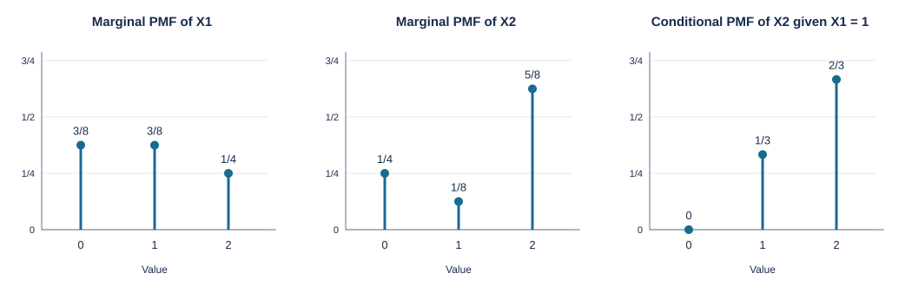

# Exercise 3: Joint PMF, Covariance Matrix, and Correlation

**Assignment 1 · Optimum Signal Processing · WS 2026**

## Given distribution

For $\mathbf{X}=[X_1,X_2]^T$, the joint probability mass function is

| $x_1\backslash x_2$ | 0 | 1 | 2 | Row sum |
|:---:|:---:|:---:|:---:|:---:|
| 0 | $1/8$ | $0$ | $1/4$ | $3/8$ |
| 1 | $0$ | $1/8$ | $1/4$ | $3/8$ |
| 2 | $1/8$ | $0$ | $1/8$ | $1/4$ |
| **Column sum** | $1/4$ | $1/8$ | $5/8$ | **1** |

All entries are nonnegative and their sum is 1. Probabilities outside $\{0,1,2\}^2$ are zero.

## (a) Marginal PMFs

Sum over the other variable:

$$p_{X_1}(x_1)=\sum_{x_2=0}^{2}p_{\mathbf{X}}(x_1,x_2),\qquad
p_{X_2}(x_2)=\sum_{x_1=0}^{2}p_{\mathbf{X}}(x_1,x_2).$$

| Value $k$ | $p_{X_1}(k)$ | $p_{X_2}(k)$ |
|:---:|:---:|:---:|
| 0 | $3/8$ | $1/4$ |
| 1 | $3/8$ | $1/8$ |
| 2 | $1/4$ | $5/8$ |

Both marginal PMFs are zero elsewhere. Their stem plots, together with the conditional PMF from part (b), are shown below.

## (b) Conditional PMF given $X_1=1$

Since $P(X_1=1)=3/8>0$,

$$p_{X_2\mid X_1}(x_2\mid 1)
=\frac{p_{\mathbf{X}}(1,x_2)}{p_{X_1}(1)}.$$

Consequently,

$$\boxed{
p_{X_2\mid X_1}(x_2\mid 1)=
\begin{cases}
0, & x_2=0,\\
1/3, & x_2=1,\\
2/3, & x_2=2,\\
0, & \text{otherwise}.
\end{cases}}
$$

For example, $(1/8)/(3/8)=1/3$ and $(1/4)/(3/8)=2/3$. These conditional probabilities sum to 1.

## (c) Mean vector

Using the marginal PMFs,

$$
\begin{aligned}
\mu_1=E[X_1]&=0\cdot\frac38+1\cdot\frac38+2\cdot\frac14=\frac78,\\
\mu_2=E[X_2]&=0\cdot\frac14+1\cdot\frac18+2\cdot\frac58=\frac{11}{8}.
\end{aligned}
$$

Thus

$$\boxed{\boldsymbol{\mu}_{\mathbf{X}}=\begin{bmatrix}7/8\\11/8\end{bmatrix}.}$$

## (d) Auto-covariance matrix

The covariance matrix is the centered second moment:

$$\mathbf{C}_{\mathbf{XX}}
=E[(\mathbf{X}-\boldsymbol{\mu}_{\mathbf{X}})(\mathbf{X}-\boldsymbol{\mu}_{\mathbf{X}})^T]
=E[\mathbf{X}\mathbf{X}^T]-\boldsymbol{\mu}_{\mathbf{X}}\boldsymbol{\mu}_{\mathbf{X}}^T.$$

First calculate the second raw moments:

$$
\begin{aligned}
E[X_1^2]&=0^2\cdot\frac38+1^2\cdot\frac38+2^2\cdot\frac14=\frac{11}{8},\\
E[X_2^2]&=0^2\cdot\frac14+1^2\cdot\frac18+2^2\cdot\frac58=\frac{21}{8}.
\end{aligned}
$$

For the mixed moment, only the entries $(1,1)$, $(1,2)$, and $(2,2)$ make nonzero contributions:

$$
E[X_1X_2]=\sum_{x_1=0}^{2}\sum_{x_2=0}^{2}x_1x_2p_{\mathbf{X}}(x_1,x_2)
=1\cdot1\cdot\frac18+1\cdot2\cdot\frac14+2\cdot2\cdot\frac18=\frac98.
$$

Therefore,

$$
\begin{aligned}
\operatorname{Var}(X_1)&=\frac{11}{8}-\left(\frac78\right)^2=\frac{39}{64},\\
\operatorname{Var}(X_2)&=\frac{21}{8}-\left(\frac{11}{8}\right)^2=\frac{47}{64},\\
\operatorname{Cov}(X_1,X_2)&=\frac98-\frac78\frac{11}{8}=-\frac5{64}.
\end{aligned}
$$

Assembling the entries gives

$$\boxed{\mathbf{C}_{\mathbf{XX}}=\frac1{64}\begin{bmatrix}39&-5\\-5&47\end{bmatrix}.}$$

**Check:** The matrix is symmetric with positive diagonal entries, and its determinant is $(39\cdot47-25)/64^2=113/256>0$, so it is positive definite.

## (e) Correlation coefficient

Normalize the covariance by the product of standard deviations:

$$
\begin{aligned}
\rho_{X_1,X_2}
&=\frac{\operatorname{Cov}(X_1,X_2)}{\sqrt{\operatorname{Var}(X_1)\operatorname{Var}(X_2)}}\\
&=\frac{-5/64}{\sqrt{(39/64)(47/64)}}
=\boxed{-\frac5{\sqrt{1833}}\approx-0.1168}.
\end{aligned}
$$

The variables have a weak negative linear correlation. They are not independent: for instance, $P(X_1=0,X_2=1)=0$, whereas $P(X_1=0)P(X_2=1)=3/64>0$.
